<p align="center">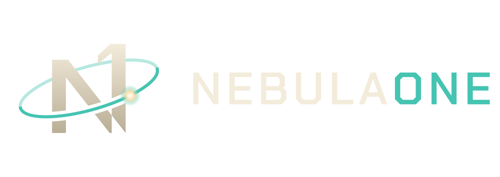</p>

**NebulaOne** puts you in the chair of a far-future corporation's CEO. You never fly a ship: you buy, mine, refine,
build, haul, lend, settle and fight through standing orders, ledgers and a live hex sector chart, in a sandbox economy
shared with AI corporations that play by the same rules you do.

Version 0.4.0: single player, Windows and Linux. The universe is generated from a seed, from an 80-system Compact
chart up to a 20,000-system Expanse. New in 0.4: divisions run by your directors, construction and megaprojects
(jump gates, Charter Beacons), planets and colonies, capital markets (futures, bonds, short selling, takeover defences
and your own underwriting desk), and windows that are easy to dock, float and put back where they started.

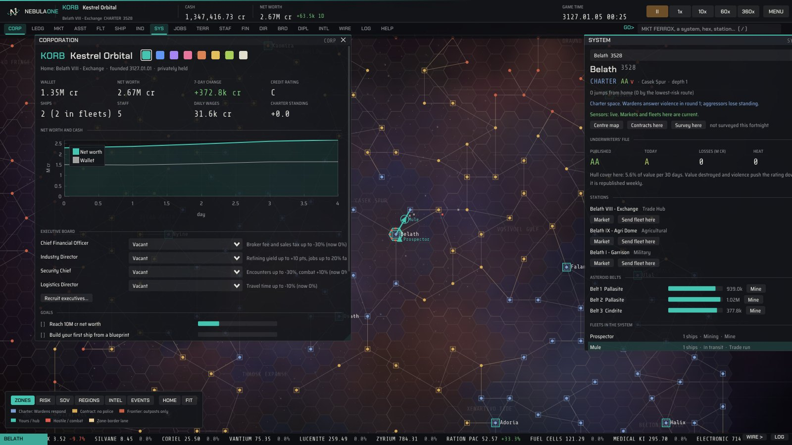

## What is in this build

| Area | Playable now |
| --- | --- |
| Universe | A procedurally generated hex sector chart: Compact (80 systems), Standard (400), Vast (2,000), Galaxy (8,000) or Expanse (20,000, experimental); regions, lanes measured in hexes, chokepoints at zone borders |
| Law | Charter space (the Wardens destroy aggressors), Contract space (no police), the Frontier (only outposts). Underwriters grade every system AAA to D from the losses and violence they see, re-rated weekly |
| Markets | An order book at every station, instant trades, limit orders with escrow, broker fees, sales tax plus a Charter levy, daily price history where corporations trade |
| Industry | Ore to minerals to components to ship modules and hulls; blueprint originals and copies; material and time efficiency research; the Outpost Kit |
| Ships | Seven hulls (including the Wisp survey frigate) with 2 to 4 fitting slots, seven module types, a Ship Information window with fitted stats and a service record |
| Fleets | Standing orders: Move, Mine, Haul, Trade run, Patrol, Raid, Siege, Survey, Salvage, Scout; route policies (Shortest, Lowest risk, Avoid Frontier); cargo insurance per trip |
| Fog of war | Live markets and fleets only where your sensors reach (headquarters, fleets, outposts, allies); everywhere else you trade on the last prices you saw, with their age. The Charter Exchange publishes its hubs' prices daily; intel brokers sell regional market reports and fleet sightings |
| Exploration | Survey any system for hidden sites, new every fortnight: derelicts and relic caches to salvage, ore pockets only you know about, and short-lived drift lanes across the chart. Rival corporations survey too |
| Diplomacy | Charter war licences make fighting a rival lawful everywhere for 14 days; war scores, peace with or without reparations; non-aggression pacts; alliances that share sensors and defend each other; mercenaries for hire. AI corporations feud, ally and hire mercenaries among themselves |
| Living galaxy | Shortages, gluts, strikes, booms, outbreaks, Charter levies and embargoes, ion storms that close lanes, raider surges, gold rushes and Warden crackdowns, many announced before they start |
| Contracts | A job board of supply, courier, bounty and patrol work; post your own; AI traders and mercenaries take work too |
| Territory | Anchor outposts in the Frontier: sovereignty, a 70% refinery, market and refinery taxes, fuel upkeep, sieges with a 24-hour reinforcement timer |
| Divisions | Seven executive seats. Directors run the mining, trade, haulage, industry, security and intelligence divisions inside the zones, radius, risk and budget you set, crew their ships, book their own profit and loss and report every 30 days. They ask for raises, get poached, and spy: dossiers, research theft, smear campaigns |
| Construction | Upgrade outposts module by module (refinery, factory, market, defence grid, silo, three tiers). Found megaprojects with other corporations: jump gates that open a new lane (backers share the tolls), Charter Beacons that bring the Wardens into Contract space, Trade Nexuses and survey arrays |
| Colonies | Every system has planets. Settle one with a Colony Kit: it grows when supplied, pays taxes, runs a spaceport market and hands you what the planet makes; habitats, extractors and spaceports upgrade it |
| Corporate | Loans both ways, the share Exchange, an IPO for your own company, a board that reviews you every 30 days, dividends, buybacks and takeovers |
| Capital markets | Cash-settled futures on the Charter hubs (margin calls, and squeezes if you can afford them); bonds you issue or buy from rivals, with coupons and defaults; short selling; poison pills, white knights and greenmail, on both sides; an underwriting desk that insures rivals' ships for premiums and pays their claims |
| UI | Smoked-glass panels over a deep-space chart, in the livery colour you pick for your corporation; a function-key strip, a GO> command line, a scrolling price tape and news wire. Windows dock together or detach onto other monitors; every window has a menu to dock it, float it or reset it, and LAYOUT resets everything or recalls a saved layout |
| Saves | Autosave every game day, named saves, quick save (F5) |

Designed but not yet built: multiplayer (the core is already server-shaped; see the design document).
The full design and roadmap are in [docs/DESIGN.md](docs/DESIGN.md).

| | |
| --- | --- |
| 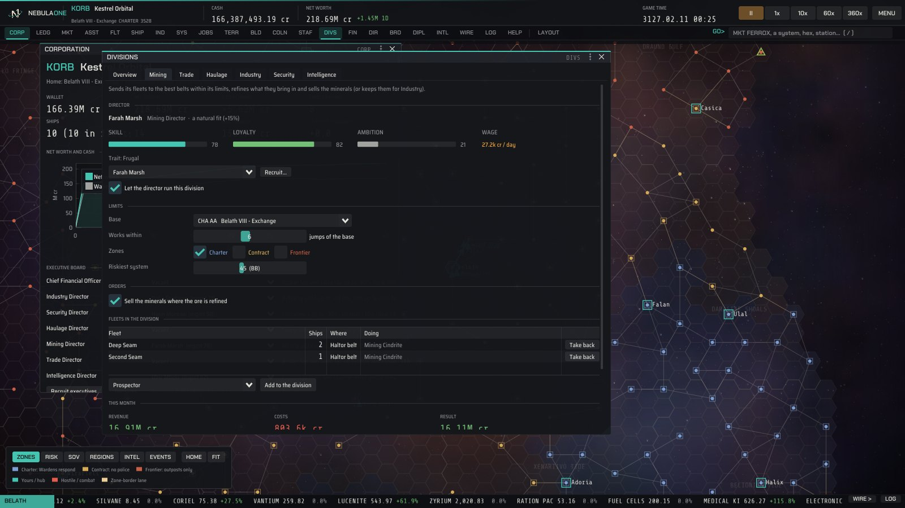 | 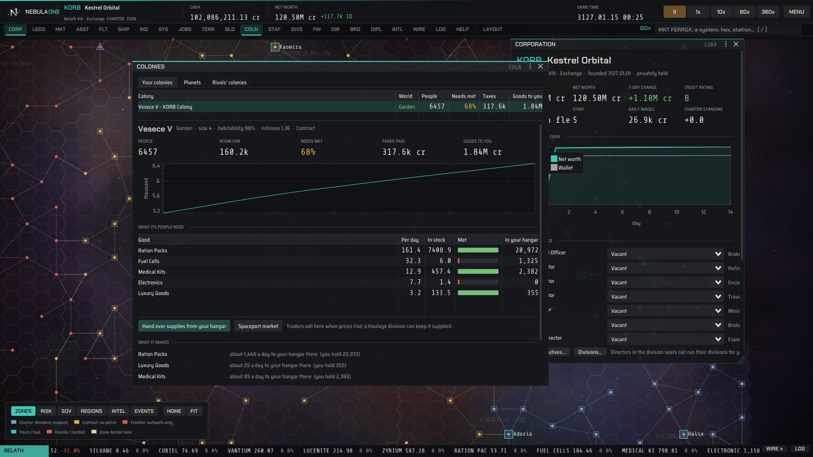 |
| 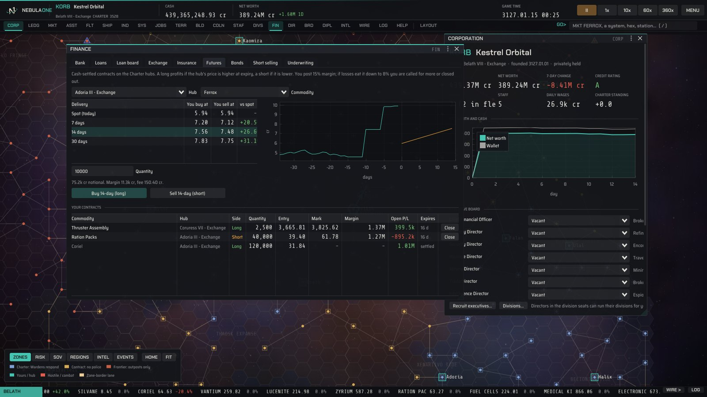 | 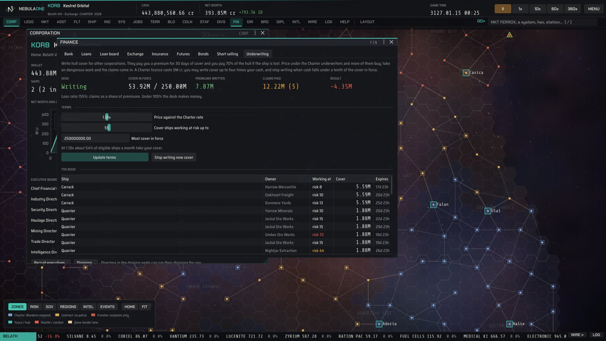 |
| 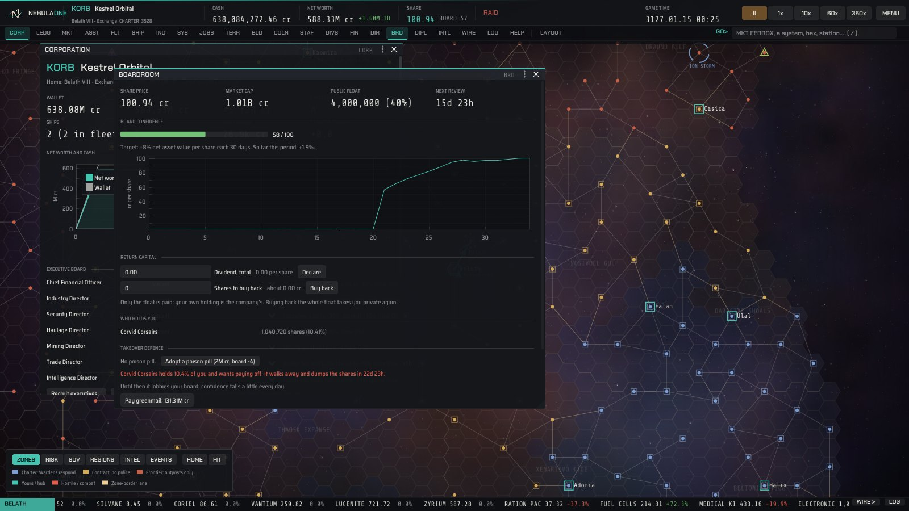 | 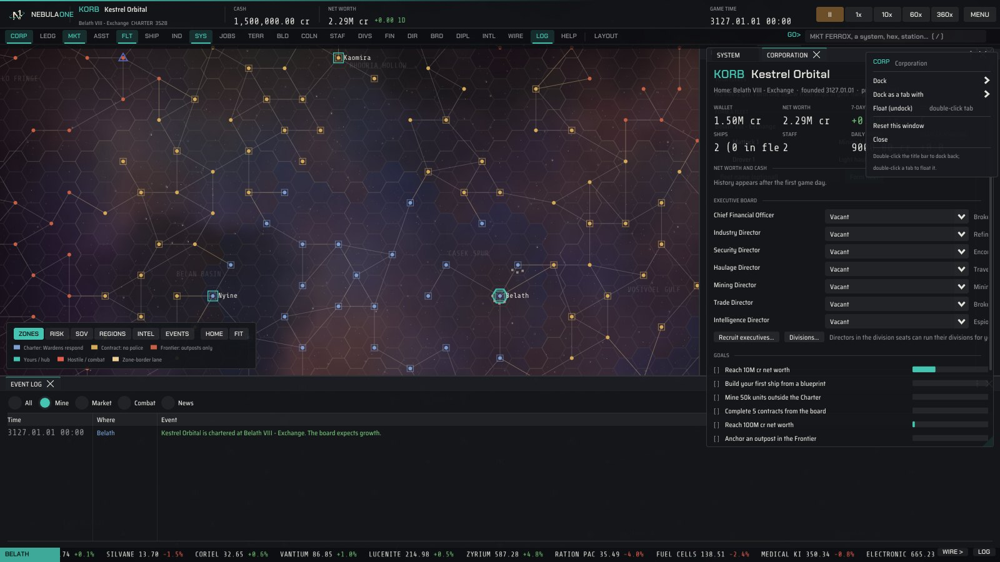 |
| 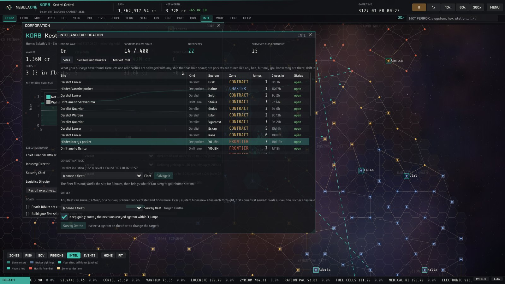 | 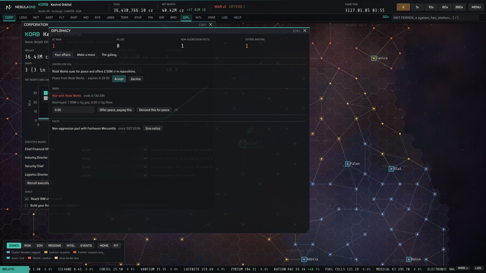 |
| 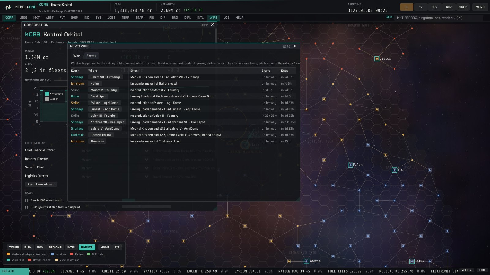 | 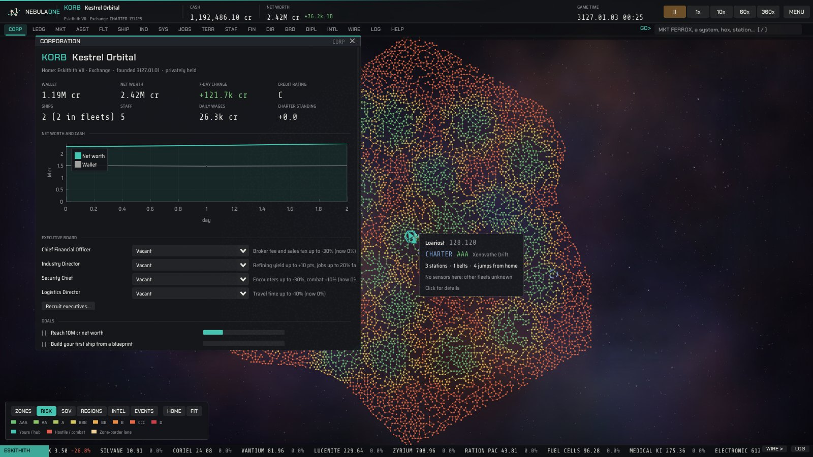 |
| 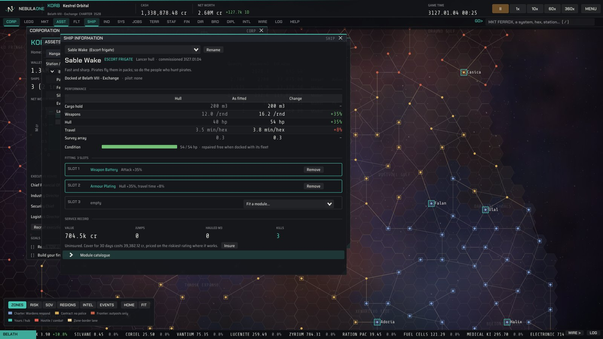 | 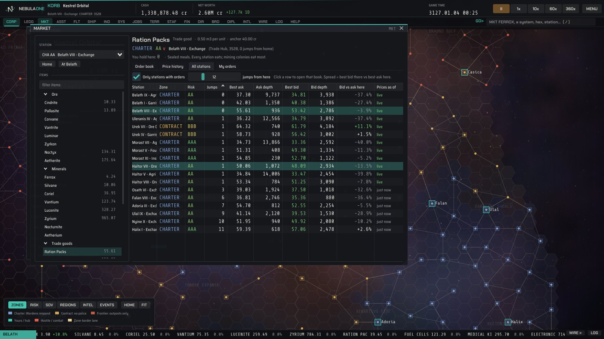 |

## Install

**Windows 10 or 11**: run `NebulaOne-0.4.0-win64.exe` (installs to Program Files with a desktop shortcut, a Start menu
entry and an uninstaller), or unzip `NebulaOne-0.4.0-win64.zip` anywhere and run `NebulaOne.exe`. Nothing else is needed. Windows SmartScreen may warn
because the build is not code-signed: choose *More info*, then *Run anyway*.

**Fedora** (40 or newer):

```bash
sudo dnf install ./nebulaone-0.4.0-1.x86_64.rpm
nebulaone
```

**Ubuntu / Debian** (24.04 or newer): `sudo apt install ./nebulaone_0.4.0_amd64.deb`

Both Linux packages add NebulaOne to the applications menu and put a launcher on the desktop of the user who ran
`sudo` (GNOME needs a desktop-icons extension to show it).

**Any Linux** (glibc 2.38 or newer): unpack `NebulaOne-0.4.0-Linux.tar.gz` and run `bin/nebulaone`. Settings, *Put a
shortcut on the desktop*, makes a launcher for it (the same button works for the Windows zip).

It needs OpenGL 3.3 (any GPU from the last decade, or Mesa's software renderer). Saves, settings and the window layout
live in `%APPDATA%\NebulaOne` on Windows and `~/.local/share/NebulaOne` on Linux.

## Playing

Start a **New corporation** with the tutorial ticked, pick a chart size (Standard is a good first game) and a livery
colour. Fog of war is on unless you untick it. The tutorial walks one full money loop: read a market, form a mining
fleet, let time run, refine, sell, then run a hauler on a trade route. After that you are on your own: survey for
derelicts, buy intel before a long trade run, read the Events tab for the next shortage, and keep an eye on DIPL.
When there is too much to run by hand, hire directors (CORP) and hand them fleets (DIVS).

| Key | Action |
| --- | --- |
| Space | Pause or resume |
| 1 to 5 | Speed: pause, 1 min/s, 10 min/s, 1 h/s, 6 h/s |
| F5 | Quick save |
| M, F, J, N | Market, Fleets, Contract Board, News Wire |
| / or ` | The GO> command line: window codes (`MKT FERROX`, `FLT`, `JOBS`), a system name, a hex id, a station or an item |
| F1 | Help |
| Chart | Drag to pan, wheel to zoom, click a system; ZONES, RISK, SOV, REGIONS, INTEL (sensor coverage) and EVENTS views at the bottom left |

Windows dock when you drag a title bar onto another window, and leave the game window when you drag them past its edge,
so you can spread the game over several monitors (Settings, *Detachable windows*); detached windows keep the
deep-space backdrop. Every window has a menu (the dots by its title, or right-click the title or tab): dock it to a side
or as a tab with another window, float it, pop it out, or reset it. Double-click a tab to float that window, and a
floating title bar to dock it back. LAYOUT on the function strip resets every window to where it started, docks
everything, and saves and recalls named layouts (also `GO> RESET` and `GO> LAYOUT name`). If windows dock when you do
not mean them to, tick *Only dock while holding Shift* in the LAYOUT menu. The layout is remembered. On
Linux this uses X11 (XWayland on Wayland desktops), because Wayland does not let programs place their own windows.

## Building from source

The project is C++20 with CMake. Dear ImGui (docking branch), ImPlot, GLFW 3.4 and stb are vendored in `third_party/`,
so the only requirements are a compiler, CMake and your platform's windowing headers.

**Fedora**

```bash
sudo dnf install cmake ninja-build gcc-c++ libXrandr-devel libXinerama-devel libXcursor-devel libXi-devel \
                 mesa-libGL-devel wayland-devel libxkbcommon-devel rpm-build
cmake -S . -B build -G Ninja -DCMAKE_BUILD_TYPE=Release
cmake --build build
./build/nebulaone
```

**Ubuntu / Debian**: the same, with `sudo apt install cmake ninja-build g++ libxrandr-dev libxinerama-dev libxcursor-dev
libxi-dev libgl1-mesa-dev libwayland-dev libxkbcommon-dev`.

**Windows**: open the folder in Visual Studio 2022 (it reads `CMakeLists.txt` directly) and build the `NebulaOne` target,
or from a *Developer PowerShell*:

```powershell
cmake -S . -B build -G "Visual Studio 17 2022" -A x64
cmake --build build --config Release
```

**Windows from Linux** (how the release `.exe` is made):

```bash
sudo dnf install mingw64-gcc-c++ mingw64-winpthreads-static nsis   # Ubuntu: mingw-w64 nsis
cmake -S . -B build-win -G Ninja -DCMAKE_TOOLCHAIN_FILE=cmake/mingw-w64-x86_64.cmake -DCMAKE_BUILD_TYPE=Release
cmake --build build-win
```

**Packages**: `cpack` in the build folder makes `.tar.gz`, `.deb` and `.rpm` on Linux, and the 64-bit NSIS installer
plus a `.zip` for Windows. `.github/workflows/build.yml` does all of it on every push.

**Screenshots without a monitor**: `xvfb-run ./build/nebulaone --screenshot shot.png --scene market --days 3` renders a
scripted scene and exits (`--chart galaxy` picks the chart size); `--scene uitest` clicks through every function key and
the tutorial with injected mouse input.

## How the code is laid out

```
src/core/      the simulation: no UI, no OpenGL (a future server links only this)
  world.h        every piece of game state, Commands, and the World class
  world.cpp      hex chart generation, routing (A*), scheduling, queries, saves
  items.cpp      ores, minerals, goods, components, modules, ships, blueprints (game data)
  market.cpp     order books, the station market makers (live or on demand), valuations
  fleet.cpp      standing orders, movement, mining, hauling, encounters, combat, the Wardens
  economy.cpp    refining, manufacturing, research, copying, loans, shares, staff
  events.cpp     the living galaxy: shortages, strikes, booms, edicts, storms, surges, gold rushes
  law.cpp        zones and the underwriters' risk ratings, insurance pricing
  contracts.cpp  the contract board
  territory.cpp  outposts, fuel, taxes and sieges
  corporate.cpp  IPO, the board, dividends, buybacks, takeovers
  capital.cpp    futures, bonds, short selling, poison pills, white knights, greenmail, the underwriting desk
  divisions.cpp  directors running divisions within your limits, monthly reports, staff requests, espionage
  projects.cpp   outpost upgrades and megaprojects: jump gates, Charter Beacons, Trade Nexuses, survey arrays
  colonies.cpp   planets (generated, never stored), colonies, their people, needs, taxes and output
  intel.cpp      fog of war: sensors, market snapshots, the Charter Exchange feed, intel brokers
  explore.cpp    surveys, hidden sites (derelicts, relic caches, ore pockets, drift lanes), salvage
  diplomacy.cpp  war licences and scores, peace, pacts, alliances, mercenaries, AI diplomacy
  ai.cpp         the AI corporations (they sample nearby stations, never the whole galaxy)
  commands.cpp   World::execute - the one door through which anything changes
src/app/       the game client: Dear ImGui windows over the hex sector chart
  theme.cpp      the glass look and liveries; backdrop.cpp draws the nebula and stars
  layout.cpp     window chrome and docking: the window menu, reset, saved layouts, pop-outs
src/main.cpp   window, OpenGL, main loop
tools/         selftest.cpp (headless economy run) and make_logo.py
```

Two rules keep it multiplayer-ready: nothing in `src/core` includes a UI header, and the UI changes the World only by
sending a `Command` to `World::execute`. The AI corporations call the same rules.

Good places to start tinkering:

- **Prices, ships, modules and blueprints**: the tables in `src/core/items.cpp`.
- **How stations behave**: `World::setupEconomy()` in `world.cpp`, and `elastic()` in `market.cpp`.
- **The law and risk**: `src/core/law.cpp`.
- **AI personalities**: `src/core/ai.cpp`, one function per profile.
- **Balance check**: `./build/nebula_selftest 90 7 --play` runs 90 game days headless and prints price indices, every
  corporation's wealth, where the money comes from, and checks that a save reloads exactly.
- **Scale check**: `./build/nebula_selftest 10 7 --size galaxy --quiet` (or `expanse`) reports generation time, game
  minutes simulated per real second and memory.
- **Feature check**: `./build/nebula_selftest --features [seed]` drives fitting, research, copying, contracts, an
  outpost and its siege, an IPO, a buyback, a takeover, fog of war and intel, surveys and salvage, events, a licensed
  war, peace, pacts, a mercenary contract, five directors running their divisions, poaching and espionage, outpost
  upgrades, a jump gate and its tolls, a Charter Beacon, a colony, futures, bonds, a short, poison pills, greenmail and
  the underwriting desk through `World::execute` (104 checks), then checks a save replays identically.

Measured on one core (Linux, Release build):

| Chart | Systems | AI corporations | Game minutes per second | Memory | Save file |
| --- | --- | --- | --- | --- | --- |
| Compact | 80 | 12 | ~85,000 | ~4 MB | 1 MB |
| Standard | 400 | 40 | ~16,000 | ~16 MB | 5-9 MB |
| Vast | 2,000 | 120 | ~3,600 | ~45 MB | 17 MB |
| Galaxy | 8,000 | 300 | ~980 | ~120 MB | 52 MB |
| Expanse | 20,000 | 600 | ~400 | ~275 MB | 113 MB |

The fastest game speed needs 360 game minutes per second.

## Third-party components

Dear ImGui, ImPlot, GLFW and stb (MIT / zlib / public domain), and the Saira Semi Condensed, Chakra Petch and Share
Tech Mono fonts (SIL Open Font License). Full texts in `THIRD_PARTY_LICENSES.md`.
